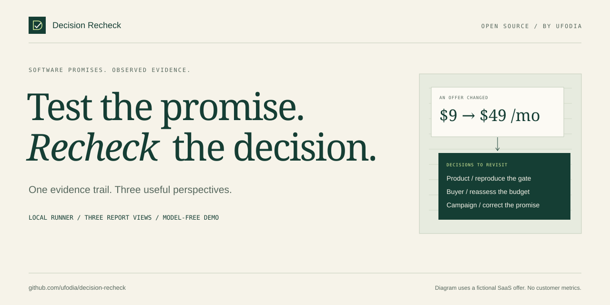
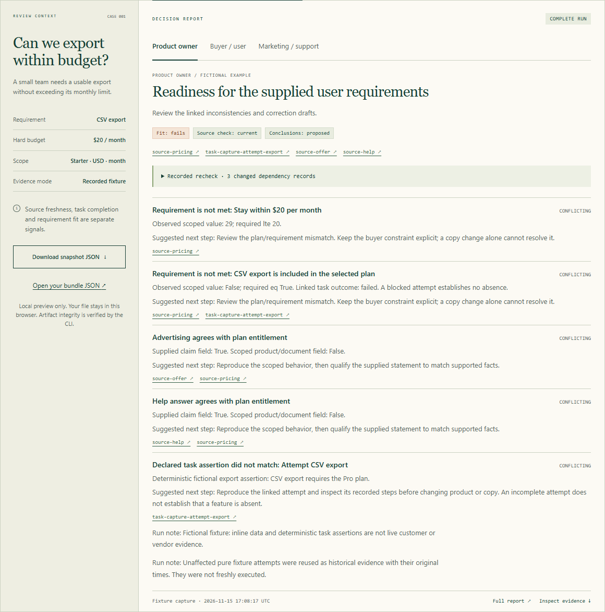
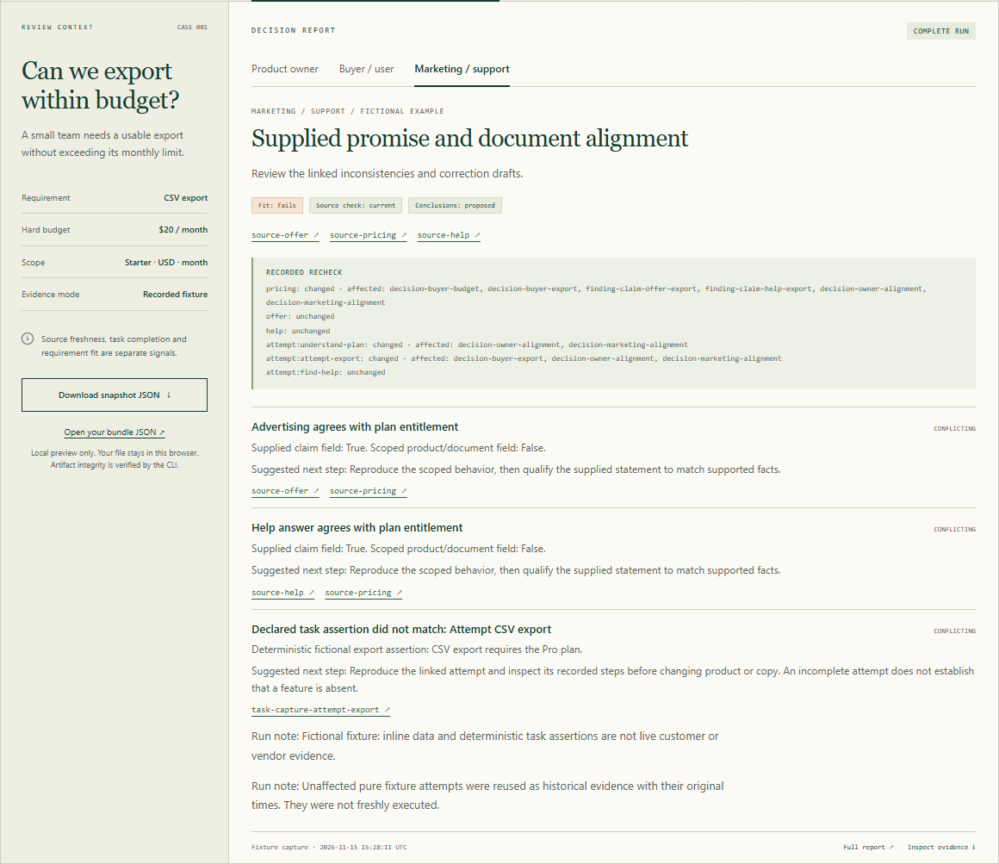
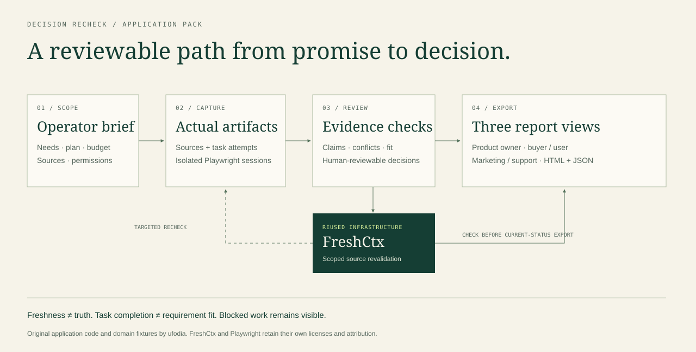

<p align="center">
  
</p>

<p align="center">
  <a href="https://decision-recheck.vercel.app/">Live demo</a> ·
  <a href="https://github.com/ufodia/decision-recheck/actions">Checks</a> ·
  <a href="#run-the-demo">Quick start</a> ·
  <a href="docs/architecture.md">Architecture</a> ·
  <a href="docs/evidence.md">Evidence contract</a> ·
  <a href="CONTRIBUTING.md">Contribute</a>
</p>

# Decision Recheck

**Your product changed. Which buying advice, campaign claim, and support answer should change with it?**

Decision Recheck is an open-source SaaS audit pack. It connects a person's requirements, a product's promises, and scoped task evidence to three reviewable reports. When an offer changes, an explicit recheck shows which conclusions need another look.

It runs locally, produces portable HTML/JSON evidence bundles, and includes a fictional release-change demonstration that requires no API key or paid inference.

<p>
  <a href="https://buymeacoffee.com/ufodia"></a>
</p>

## One evidence bundle. Three useful decisions.

| Reader | What the report helps answer |
| --- | --- |
| **Product owner** | Which promise, plan, or task outcome disagrees with the product? What should we reproduce and fix? |
| **Buyer or user** | Does this plan meet my actual requirements and budget? What remains unknown? |
| **Marketing and support** | Which supplied statements or help answers need new evidence, qualification, or corrected wording? |

Each conclusion retains its evidence basis and scope. Observed task behavior, vendor documentation, freshness, requirement fit, and human review remain separate.

## The case that explains it

The included **fictional** application offers CSV export on a $9/month Starter plan. The buyer has a $20/month limit.

1. **Baseline:** the offer, help text, and export outcome agree.
2. **Changed offer:** Starter rises to $29; export moves to $49 Pro; the ad and help answer still describe the old offer.
3. **Corrected copy:** the ad and help text are fixed. The buyer's budget failure remains.
4. **Clean control:** only a footer changes. The scoped offer evidence should remain equivalent.

The demo explains how one product change affects three decisions. It does not simulate customer conversion or establish market demand.



<details>
<summary><strong>Explore the buyer and marketing/support reports</strong></summary>

<p><strong>Buyer / user:</strong> explicit budget and feature requirements, with evidence and unknowns.</p>

<p><strong>Marketing / support:</strong> supplied statements compared with scoped product evidence.</p>


</details>

## Run the demo

Requirements: **Python 3.12** and [uv](https://docs.astral.sh/uv/). Use a normal checkout on Windows or Linux.

```sh
git clone https://github.com/ufodia/decision-recheck.git
cd decision-recheck
uv sync --locked
uv run decision-recheck demo --output runs/demo
```

Open `runs/demo/index.html`. The demo writes actual CLI bundles and role reports for the four fictional snapshots. It makes no paid model calls.

To reproduce browser task checks, install the browser once:

```sh
uv run playwright install --no-shell chromium
```

On a Linux host that needs browser system libraries, follow [Playwright's installation guidance](https://playwright.dev/python/docs/intro). Network access is needed for initial dependency/browser installation.

To use an installed browser explicitly, set `DRC_BROWSER_CHANNEL=chrome` or `msedge`. Windows verification uses Chrome in a separate temporary test profile. The default `chromium` channel needs the Playwright browser installation; the runner never silently switches browsers.

## Review an application

```sh
uv run decision-recheck init --output brief.json
# Edit the generated brief: requirements, scope, sources, tasks, and limits.
uv run decision-recheck run --brief brief.json --output runs/baseline
uv run decision-recheck validate --bundle runs/baseline
uv run decision-recheck report --bundle runs/baseline --view buyer --output runs/baseline/buyer-review.html
```

Review the generated brief before running it. Use synthetic inputs and a designated test application for any allowed state-changing task. Authentication, CAPTCHA, and unavailable pages must remain visible as blocked or unknown work.

After a source or offer changes:

```sh
uv run decision-recheck recheck --baseline runs/baseline --brief brief.json --output runs/recheck
```

See [usage and setup](docs/usage.md) for the case contract and operating limits. All output paths are local. Keep private runs outside version control.

## What makes the evidence useful

- **Scoped:** plan, locale, currency, billing period, capture time, and method travel with a finding.
- **Inspectable:** local artifacts and stable references support the report; validation detects missing or altered evidence.
- **Honest about access:** an untested or blocked workflow stays untested or blocked.
- **Rechecked against current sources:** an unchanged archive hash cannot establish that a live page is still the same.
- **Reviewable:** a proposed interpretation remains distinguishable from an accepted decision.
- **Portable:** local HTML reports and JSON bundles can be inspected without a hosted account.



## Architecture and upstream credit

The original application layer contains SaaS case definitions, task recipes, finding/fit interpretation, report views, fixtures, and a skill entry point. **[FreshCtx](https://github.com/Hyperwise-LLC/freshctx)** supplies the declared-dependency and freshness mechanisms. **[Playwright](https://playwright.dev/python/)** supplies browser contexts and trace facilities.

The coordinator enforces the configured actions and budgets. Model output proposes structured findings; it does not gain permission to execute arbitrary Python, shell commands, or page instructions. A skill following the [Agent Skills format](https://agentskills.io/specification) invokes the same runner.

Read [architecture](docs/architecture.md), [evidence semantics](docs/evidence.md), and [third-party notices](THIRD_PARTY_NOTICES.md).

## Scope and limitations

This is an early, bounded audit pack. An initial case targets one application, 3–5 requirements, at most ten claims, and up to three task attempts per snapshot. An optional alternative can contribute public documentary evidence; it must not be presented as browser-tested unless it actually was.

Source freshness does not establish factual truth. A successful task does not establish human usability or future availability. Several agents repeating one page are not independent confirmations. This software does not infer real purchase probability, conversion uplift, ROI, or demand from fictional users.

The static demo displays fictional local results. It has no server-side model key or remote audit service. Live model access is opt-in and may incur the operator's provider charges. See [model access and privacy](docs/model-and-privacy.md) for the tested contract and verification limits.

The [live demo](https://decision-recheck.vercel.app/) is hosted on Vercel. See [deployment and recovery](docs/deployment.md) for the static hosting configuration and verification steps.

## Verify and restore

```sh
uv sync --locked
uv run python scripts/check.py
uv build
uv run decision-recheck demo --output runs/demo
uv run decision-recheck validate --bundle runs/demo/A
```

The [validation record](docs/validation.md) separates local checks, mocked provider behavior, and live external coverage. GitHub `main` holds the source, lockfile, fixtures, documentation, and deployment configuration. Run bundles and credentials are intentionally excluded.

`scripts/check.py` starts and stops its own loopback preview, so the static demo checks run alongside the Python tests. `uv run pytest` alone leaves those optional UI checks skipped unless `DRC_DEMO_URL` is supplied. Set the browser channel explicitly for the browser installed on your machine.

## Contribute a case worth catching

Good first contributions include a scoped source extractor, a clean control, a malformed evidence fixture, or a false-positive reproduction. Start with [CONTRIBUTING.md](CONTRIBUTING.md). Use synthetic data, small patches, and short commit summaries.

Current first-party maintainer and contributor: **[ufodia](https://github.com/ufodia)**. Upstream projects retain their own attribution.

## Support maintenance

If the pack saves you review work, [buy ufodia a coffee](https://buymeacoffee.com/ufodia). Support helps maintain reproducible SaaS fixtures, browser compatibility, and clear documentation. The core and model-free demo remain open source.

## License

Original project code, documentation, fixtures, and artwork: **MIT, Copyright © 2026 ufodia**. See [LICENSE](LICENSE) and [THIRD_PARTY_NOTICES.md](THIRD_PARTY_NOTICES.md).
