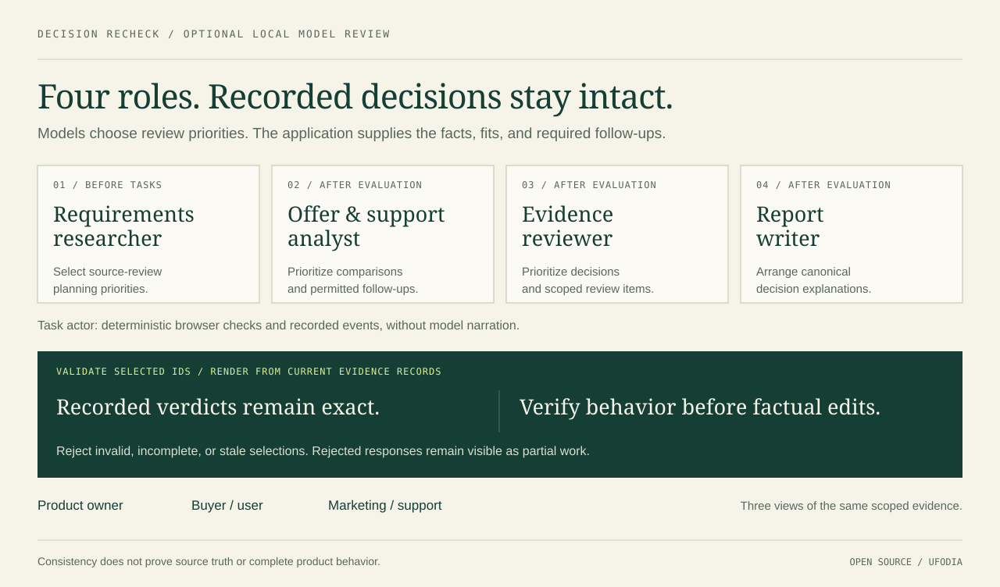
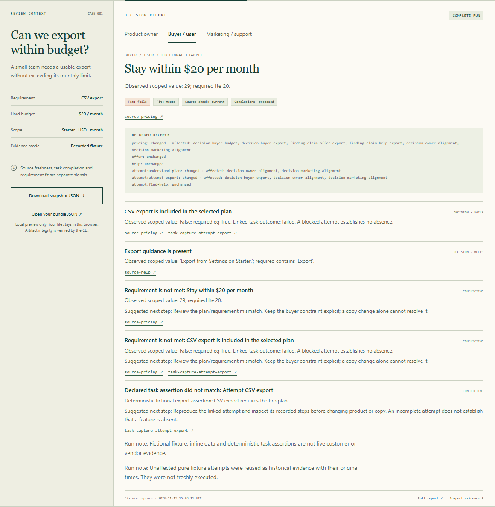

<p align="center">
  
</p>

<p align="center">
  <a href="https://decision-recheck.vercel.app/">Live demo</a> ·
  <a href="https://github.com/ufodia/decision-recheck/actions">Checks</a> ·
  <a href="#run-the-demo">Quick start</a> ·
  <a href="#four-model-roles-one-decision-contract">Four roles</a> ·
  <a href="#real-llm-validation">Live LLM validation</a> ·
  <a href="docs/architecture.md">Architecture</a> ·
  <a href="CONTRIBUTING.md">Contribute</a>
</p>

# Decision Recheck

**Your product changed. Which buying advice, campaign claim, and support answer should change with it?**

Decision Recheck is an open-source SaaS audit pack. It connects a person's requirements, a product's promises, and scoped task evidence to three reviewable reports. When an offer changes, an explicit recheck shows which conclusions need another look.

**Four optional LLM roles help prioritize the review. The application renders the exact recorded decisions and required follow-ups.** A model cannot soften a recorded failure into a readiness claim.

It runs locally and produces portable HTML/JSON evidence bundles. The [real LLM validation](#real-llm-validation) records a fresh four-role baseline and recheck against public HTTPX documentation. The interactive fictional demo requires no API key or paid inference.

**Start here:** [explore the interactive example](https://decision-recheck.vercel.app/#demo), [run it locally](#run-the-demo), or [configure a real review](docs/usage.md#connect-your-own-product).

<p>
  <a href="https://buymeacoffee.com/ufodia"></a>
</p>

## One evidence bundle. Three useful decisions.

| Reader | What the report helps answer |
| --- | --- |
| **Product owner** | Which promise, plan, or task outcome disagrees with the product? What should we reproduce and fix? |
| **Buyer or user** | Does this plan meet my actual requirements and budget? What remains unknown? |
| **Marketing and support** | Which supplied statements or help answers need new evidence, qualification, or corrected wording? |

Each conclusion retains its evidence basis and scope. Observed task behavior, vendor documentation, freshness, requirement fit, and human review remain separate.

## Four model roles. One decision contract.

With explicit `--live-model`, the local runner requests four role reviews from your configured provider. Each role selects and orders allowed item IDs from an application-owned catalog for its current context.

| Role | Stage | What it contributes |
| --- | --- | --- |
| **Requirements researcher** | Before task execution | Selects source-review planning priorities. It does not certify requirement fulfillment. |
| **Offer and support analyst** | After evaluation | Prioritizes recorded comparisons and permitted follow-ups. |
| **Evidence reviewer** | After evaluation | Prioritizes recorded decisions, evidence limits, and follow-ups. |
| **Report writer** | After evaluation | Arranges the application's decision explanations for review. |

The **browser task actor is deterministic**: it executes the declared checks and records events directly, without model narration. Four model roles and three audience reports serve different purposes; they are not independent confirmations of a claim.



The output contract keeps model-selected priorities attached to the current evidence:

- **Exact decisions:** the later roles must include every formal fit decision. A recorded `fails` remains `fails`.
- **Required preconditions:** verify the underlying behavior **before changing factual documentation**. A preferred buyer outcome does not make a documented fact wrong.
- **Strict validation:** unknown or duplicate IDs, omitted required items, extra prose, replacement verdicts, stale context, and mismatched evidence references are rejected. Rejected work remains partial, without silent repair, hidden retry, or provider fallback.

The application rebuilds the wording from current bundle records. This ensures consistency with those records; it does not establish source truth, correct operator criteria, or complete product behavior. See the [decision-consistent review contract](docs/commentary-consistency.md).

## What runs where

| Experience | What you provide | What you get |
| --- | --- | --- |
| **Browser demo** | Nothing; no account or API key | Four recorded fictional snapshots, three report views, captured artifacts and a downloadable evidence ZIP. |
| **Local audit runner** | A JSON brief with sources, requirements and fixed task assertions | Captured evidence, scoped findings, audience reports and an explicit recheck against a previous run. |
| **Four optional model roles** | Your compatible provider, model and API key; explicit `--live-model` | Prioritized canonical review items, with decisions and required follow-ups rendered by the application. Human review still matters. |

The website is an evidence viewer. To review your own application, use the local runner. Importing a bundle JSON into the website previews its metadata locally; it neither runs an audit nor verifies the bundle's artifact files.

## Real LLM validation

On **November 15, 2026**, the current contract was tested against the real **HTTPX Introduction and QuickStart documentation**, using OpenAI **`gpt-4.1-mini`**. The completed baseline and recheck used **eight distinct new provider responses**, with no recorded response replayed or substituted.

| Verification | Recorded result |
| --- | --- |
| **Fresh baseline** | Four new role responses; all four selections accepted. |
| **Fresh recheck** | Four new role responses; all four selections accepted. A real read-only browser task reran and passed its three text assertions. |
| **Decision preservation** | Three requirements meet, one intentionally incompatible timeout criterion fails, and a two-hour support SLA stays inconclusive within the selected evidence. The recorded fits and behavior-verification precondition remain intact. |
| **Full local suite** | 335 tests passed, zero skipped, on Windows with installed Chrome. |

The website checks inspected documentation. They did not execute HTTPX's library behavior, measure a runtime timeout, test a support service, or establish human usability. The later model roles selected the required minimum catalog items, demonstrating live contract compliance rather than novel insights or independent corroboration.

An earlier strict attempt rejected two invalid selections and remained partial. Clarifying the request's mandatory IDs allowed both completed runs to pass the unchanged validation boundary. Read the [live validation record](docs/commentary-live-validation-2026-11-15.md) and its [sanitized execution evidence](docs/evidence/commentary-consistency-2026-11-15.json) for scope, timestamps, usage, and limits.

## The case that explains it

The included **fictional** application offers CSV export on a $9/month Starter plan. The buyer has a $20/month limit.

1. **Baseline:** the offer, help text, and export outcome agree.
2. **Changed offer:** Starter rises to $29; export moves to $49 Pro; the ad and help answer still describe the old offer.
3. **Corrected copy:** the ad and help text are fixed. The buyer's budget failure remains.
4. **Clean control:** only a footer changes. The scoped offer evidence should remain equivalent.

The demo explains how one product change affects three decisions. It does not simulate customer conversion or establish market demand.


<details>
<summary><strong>Explore the buyer and marketing/support reports</strong></summary>

<p><strong>Buyer / user:</strong> explicit budget and feature requirements, with evidence and unknowns.</p>

<p><strong>Marketing / support:</strong> supplied statements compared with scoped product evidence.</p>


</details>

## Run the demo

Requirements: **Python 3.12** and [uv](https://docs.astral.sh/uv/). Use a normal checkout on Windows or Linux.

```sh
git clone https://github.com/ufodia/decision-recheck.git
cd decision-recheck
uv sync --locked
uv run decision-recheck demo --output runs/demo
```

Open `runs/demo/index.html`. The demo writes actual CLI bundles and audience reports for the four fictional snapshots. **No browser installation or API key is needed for this command.** It makes no paid model calls.

```text
runs/demo/
├── index.html                 # Start here: compare all four snapshots
├── A/                        # Original offer
├── B/                        # Changed plan, old copy
├── C/                        # Repaired copy, unchanged buyer constraint
└── footer/                   # Cosmetic-change control
    ├── bundle.json           # Versioned evidence and decision records
    ├── report-owner.html     # Also report-buyer.html and report-marketing.html
    └── artifacts/            # Captured source and task evidence
```

Output directories must be new or empty. For a second run, choose a new path such as `runs/demo-2`; existing evidence is never silently replaced.

To reproduce browser task checks, install the browser once:

```sh
uv run playwright install --no-shell chromium
```

On a Linux host that needs browser system libraries, follow [Playwright's installation guidance](https://playwright.dev/python/docs/intro). Network access is needed for initial dependency/browser installation.

To use an installed browser explicitly, set `DRC_BROWSER_CHANNEL=chrome` or `msedge`. Windows verification uses Chrome in a separate temporary test profile. The default `chromium` channel needs the Playwright browser installation; the runner never silently switches browsers.

<details>
<summary><strong>Windows PowerShell: use your installed Chrome</strong></summary>

```powershell
$env:DRC_BROWSER_CHANNEL = "chrome"
uv run python scripts/check.py
```

The runner opens a separate temporary context; it does not use your signed-in Chrome profile. The setting applies to the current shell.

</details>

## Review an application

```sh
uv run decision-recheck init --output brief.json
# Edit the generated brief: requirements, scope, sources, tasks, and limits.
uv run decision-recheck run --brief brief.json --output runs/baseline
uv run decision-recheck validate --bundle runs/baseline
uv run decision-recheck report --bundle runs/baseline --view buyer --output runs/baseline/buyer-review.html
```

Review the generated brief before running it. Use synthetic inputs and a designated test application for any allowed state-changing task. Authentication, CAPTCHA, and unavailable pages must remain visible as blocked or unknown work.

`init` starts with fictional inline data and fixture tasks. Replace those deliberately with your own allowed sources and browser assertions; changing only the product name does not create a live audit. The [own-product guide](docs/usage.md#connect-your-own-product) explains the required edits.

After a source or offer changes:

```sh
uv run decision-recheck recheck --baseline runs/baseline --brief brief.json --output runs/recheck
```

See [usage and setup](docs/usage.md) for the case contract and operating limits. All output paths are local. Keep private runs outside version control.

## What makes the evidence useful

- **Scoped:** plan, locale, currency, billing period, capture time, and method travel with a finding.
- **Inspectable:** local artifacts and stable references support the report; validation detects missing or altered evidence.
- **Honest about access:** an untested or blocked workflow stays untested or blocked.
- **Rechecked against current sources:** an unchanged archive hash cannot establish that a live page is still the same.
- **Reviewable:** model-selected priorities remain distinct from recorded fits and human acceptance.
- **Portable:** local HTML reports and JSON bundles can be inspected without a hosted account.


## Architecture and upstream credit

The original application layer contains SaaS case definitions, task recipes, finding/fit interpretation, report views, fixtures, and a skill entry point. **[FreshCtx](https://github.com/Hyperwise-LLC/freshctx)** supplies the declared-dependency and freshness mechanisms. **[Playwright](https://playwright.dev/python/)** supplies browser contexts and trace facilities.

The coordinator enforces configured actions and budgets. Models select canonical review priorities; they cannot replace decision wording, execute arbitrary Python or shell commands, or turn page text into instructions. A skill following the [Agent Skills format](https://agentskills.io/specification) invokes the same runner.

Read [architecture](docs/architecture.md), [evidence semantics](docs/evidence.md), and [third-party notices](THIRD_PARTY_NOTICES.md).

## Scope and limitations

This is an early, bounded audit pack. An initial case targets one application, 3–5 requirements, at most ten claims, and up to three task attempts per snapshot. An optional alternative can contribute public documentary evidence; it must not be presented as browser-tested unless it actually was.

Source freshness does not establish factual truth. A successful task does not establish human usability or future availability. Several agents repeating one page are not independent confirmations. This software does not infer real purchase probability, conversion uplift, ROI, or demand from fictional users.

The static demo displays fictional local results. It has no server-side model key or remote audit service. Live model access is opt-in and may incur the operator's provider charges. See [model access and privacy](docs/model-and-privacy.md) for the tested contract and verification limits.

To check an actual deployed website with optional model review, follow the [bounded live-site walkthrough](docs/live-site-review.md). It includes a read-only brief, explicit provider configuration, known positive/negative/unknown requirements, and a baseline/recheck review checklist. Models receive selected structured evidence and citation metadata, not full raw files or screenshot pixels.

The [earlier HTTPX review](docs/httpx-live-validation-2026-11-15.md) preserves the free-form recommendation problems that motivated the current contract. Its prose limitations are historical context; the [current live validation](docs/commentary-live-validation-2026-11-15.md) verifies the enforced report boundary.

The [live demo](https://decision-recheck.vercel.app/) is hosted on Vercel. See [deployment and recovery](docs/deployment.md) for the static hosting configuration and verification steps.

## Verify and restore

```sh
uv sync --locked
uv run python scripts/check.py
uv build
uv run decision-recheck demo --output runs/restore-check
uv run decision-recheck validate --bundle runs/restore-check/A
```

The [validation record](docs/validation.md) separates local checks, mocked provider behavior, and live external coverage. GitHub `main` holds the source, lockfile, fixtures, documentation, and deployment configuration. Run bundles and credentials are intentionally excluded.

`scripts/check.py` starts and stops its own loopback preview, so the static demo checks run alongside the Python tests. `uv run pytest` alone leaves those optional UI checks skipped unless `DRC_DEMO_URL` is supplied. Set the browser channel explicitly for the browser installed on your machine.

## Contribute a case worth catching

Good first contributions include a scoped source extractor, a clean control, a malformed evidence fixture, or a false-positive reproduction. Start with [CONTRIBUTING.md](CONTRIBUTING.md). Use synthetic data, small patches, and short commit summaries.

Current first-party maintainer and contributor: **[ufodia](https://github.com/ufodia)**. Upstream projects retain their own attribution.

## Support maintenance

If the pack saves you review work, [buy ufodia a coffee](https://buymeacoffee.com/ufodia). Support helps maintain reproducible SaaS fixtures, browser compatibility, and clear documentation. The core and model-free demo remain open source.

## License

Original project code, documentation, fixtures, and artwork: **MIT, Copyright © 2026 ufodia**. See [LICENSE](LICENSE) and [THIRD_PARTY_NOTICES.md](THIRD_PARTY_NOTICES.md).
